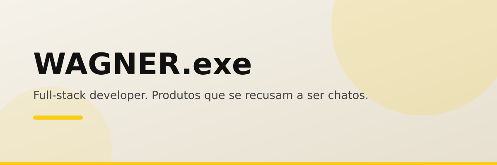

<div align="center">

[](https://github.com/Wagner-Schemmer/wagner-neo-portfolio/stargazers)
[](https://wagner-port.vercel.app)


  <a href="https://wagner-port.vercel.app"></a>

  <h1>WAGNER.exe</h1>

  <p>
    <b>Full-stack developer. Produtos digitais que se recusam a ser chatos.</b>
    <br />
    Portfólio neobrutalista com projetos ao vivo, CV PT/EN e estatísticas do GitHub.
  </p>

  <p>
    <a href="https://wagner-port.vercel.app"><b>Demo</b></a> ·
    <a href="#o-que-cada-secao-mostra">Seções</a> ·
    <a href="#como-rodar">Como rodar</a> ·
    <a href="#personalizar">Personalizar</a> ·
    <a href="#stack">Stack</a>
  </p>
</div>

<a href="https://wagner-port.vercel.app"></a>

Base: Arham43-ops/NeoBrutalist, adaptado e expandido — estrutura profissional separada (sem monolito, sem React), com cursor custom, cards de projetos apontando para demos reais e CVs em PT/EN.

## O que cada seção mostra

| Seção | O que mostra |
|---|---|
| **About** | Quem sou, status do sistema, stack |
| **Habilidades** | Barras e badges por tecnologia |
| **Trabalhos** | Cards com print, descrição e link ao vivo de cada projeto |
| **Logs** | Linha do tempo do que foi construído |
| **Contato** | WhatsApp, LinkedIn, portfólio |

## Como rodar

1. Abra o `index.html` (Go Live no VSCode ou `npx serve .`).
2. Confira as seções e os links dos projetos.
3. Deploy: conectar o repo na Vercel (site estático).

## Estrutura

```
wagner-neo-portfolio/
├── index.html            # markup + seções (about/skills/experience/stats/projects/reports/contact)
├── css/
│   ├── variables.css     # tokens (cores neo-*, sombras)
│   ├── components.css    # cursor, marquee, cards, animações
│   └── style.css         # base body + grid
├── js/
│   ├── tailwind.config.js # paleta + font + shadows (Tailwind CDN)
│   ├── cursor.js          # cursor custom difference
│   ├── github-stats.js    # fetch GitHub → stats ao vivo
│   └── ui.js              # reveal on scroll + progress bar
└── Assets/
    ├── images/            # fotos e prints dos projetos
    └── Resume/            # CV em PT e EN
```

## Personalizar

1. `Assets/images/` → fotos e prints dos seus projetos.
2. `Assets/Resume/` → CVs em PDF.
3. `js/github-stats.js` → seu username do GitHub.
4. Seção projects no `index.html` → seus projetos com links ao vivo.
5. Cores em `css/variables.css` + `js/tailwind.config.js` (mantém sincronizado).

## Stack

HTML · Tailwind (CDN) · JavaScript. Sem build.

## Quem faz

<a href="https://github.com/Wagner-Schemmer/wagner-neo-portfolio/graphs/contributors"></a>

## Star history

<a href="https://www.star-history.com/#Wagner-Schemmer/wagner-neo-portfolio&Date"></a>

---
[Wagner Schemmer](https://wagner-port.vercel.app) · [LinkedIn](https://www.linkedin.com/in/wagner-schemmer-martins-46950627a)
