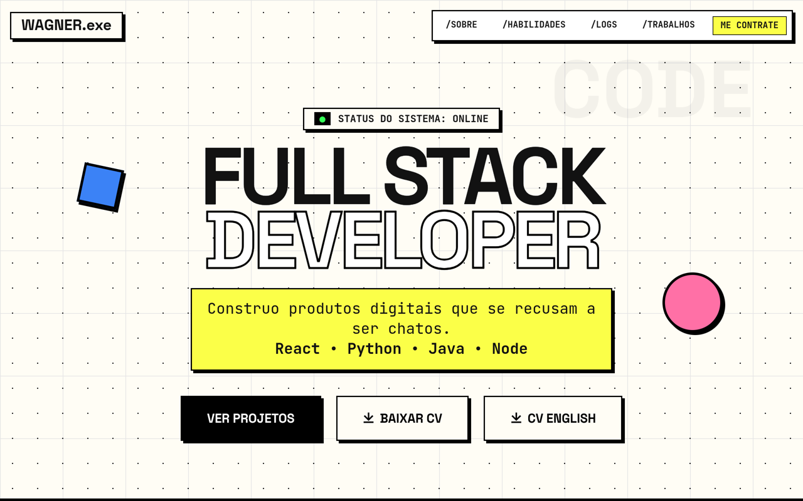
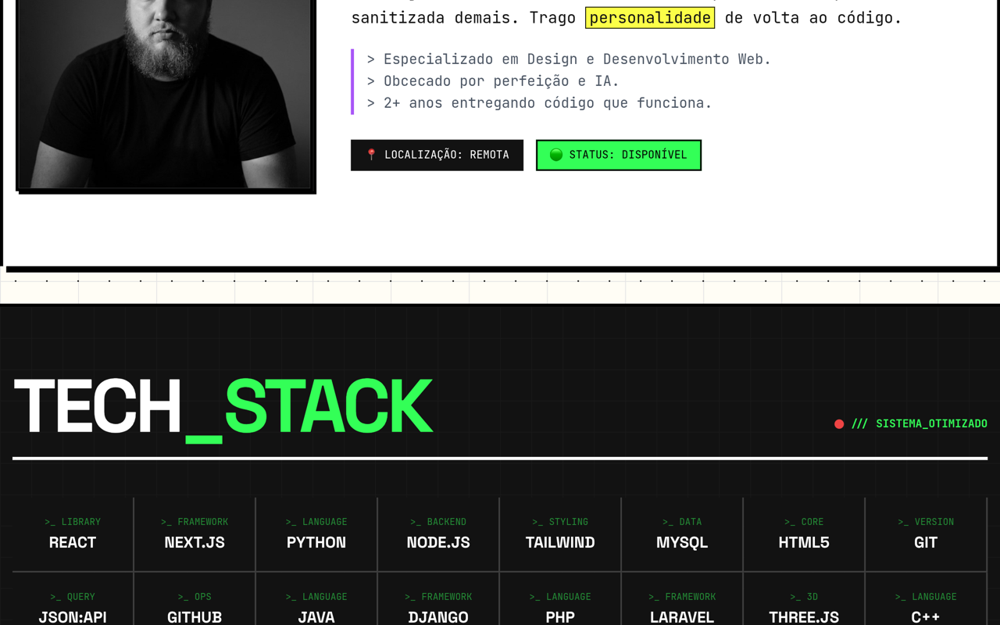

<div align="center">

```
WAGNER.exe v2.0 — (c) 2026
> boot portfolio-tests... OK
> projetos ao vivo....... 8 ONLINE
> café................... OK
> status: CONTRATÁVEL_
```

[](https://wagner-port.vercel.app)
[](https://wagner-port.vercel.app)

</div>

<a href="https://wagner-port.vercel.app"></a>

## SCREENSHOTS_DO_SISTEMA

**Tela QUEM_SOU + TECH_STACK:**
<a href="https://wagner-port.vercel.app"></a>

## SYSTEM SPECS

| Componente | Valor |
|---|---|
| Modelo | Wagner Schemmer Martins, IFFar FW |
| Render | Neobrutalista, sem monolito, sem React |
| Cursor | Custom `difference`, sem misericórdia |
| Projetos | Cards com print + demo real (nada de lorem) |
| CV | PT + EN em `Assets/Resume/` |
| Stats | GitHub ao vivo via `js/github-stats.js` |

## COMANDOS

```bash
git clone https://github.com/Wagner-Schemmer/wagner-neo-portfolio.git
npx serve .          # ou Go Live no VSCode
```

## DRIVERS_INSTALADOS

<div align="center">
  
</div>

## CONFIGURAR O SISTEMA

1. `Assets/images/` → fotos e prints dos seus projetos
2. `Assets/Resume/` → CVs em PDF
3. `js/github-stats.js` → seu username
4. `index.html` → seção projects com links ao vivo
5. `css/variables.css` + `js/tailwind.config.js` → cores sincronizadas

---
`pressione qualquer tecla para contratar_` → [wagner-port.vercel.app](https://wagner-port.vercel.app) · [LinkedIn](https://www.linkedin.com/in/wagner-schemmer-martins-46950627a)
